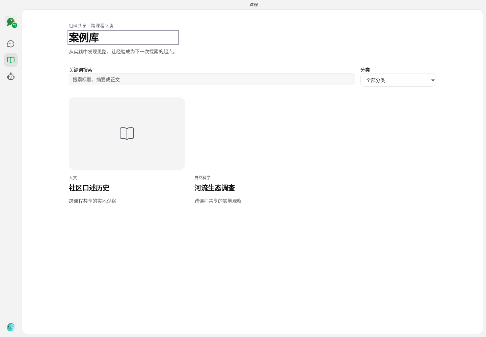
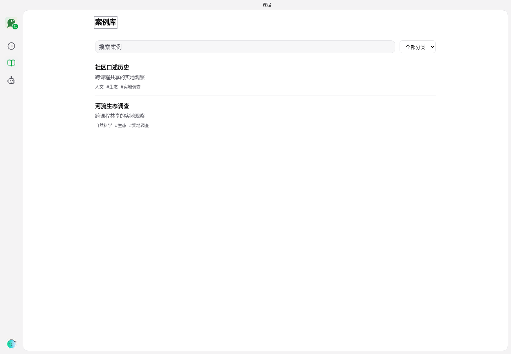
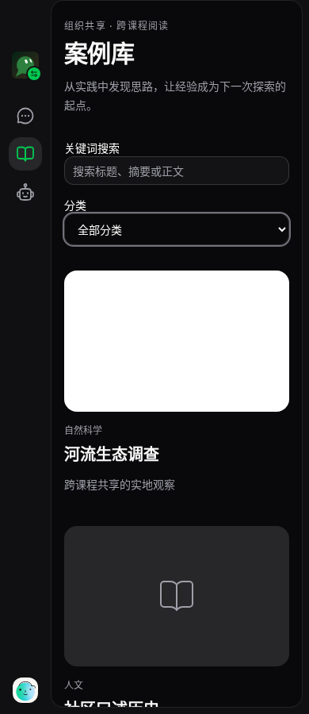
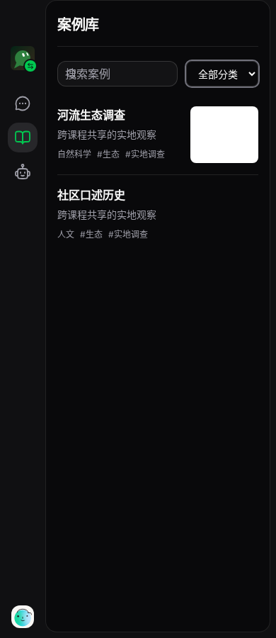
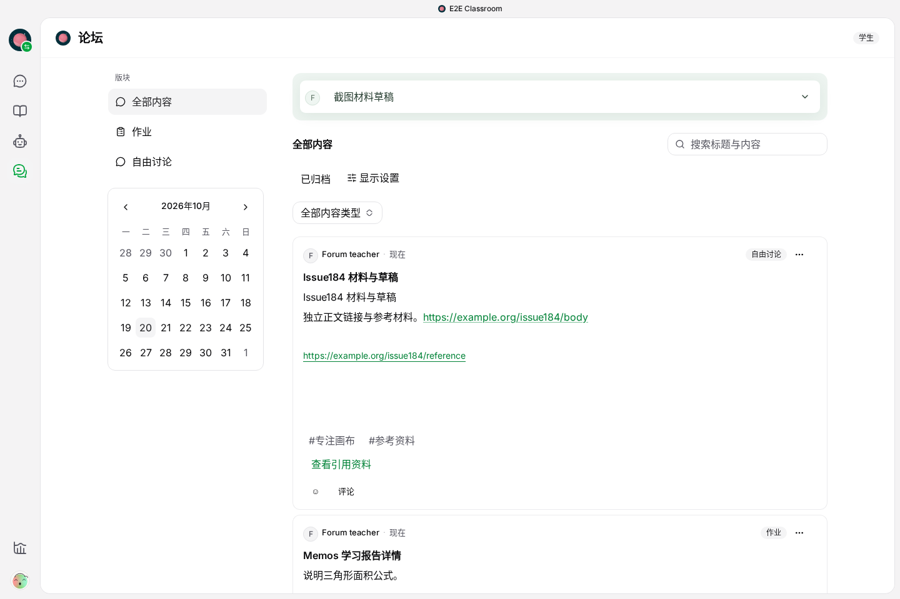
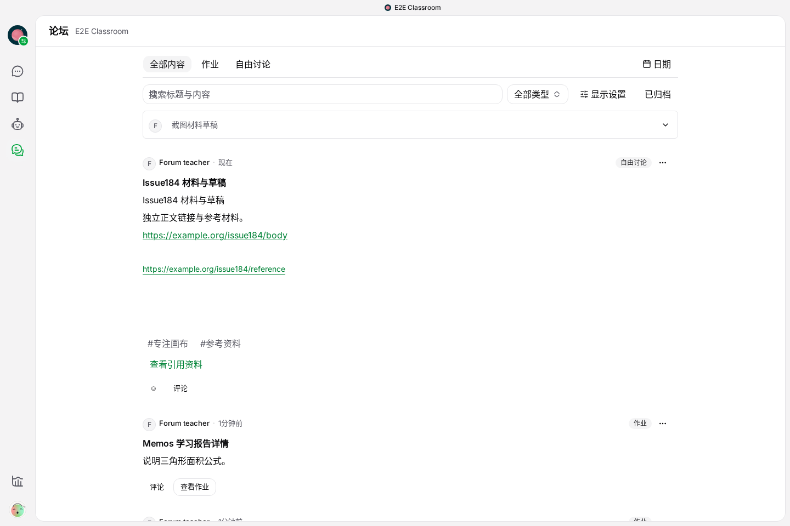
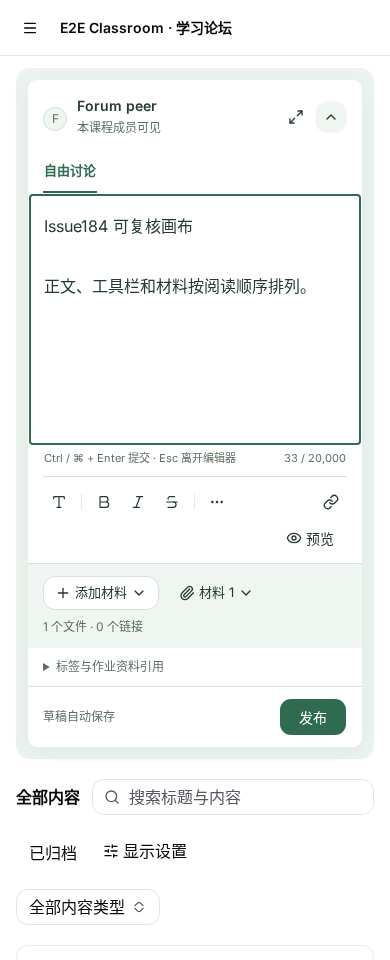
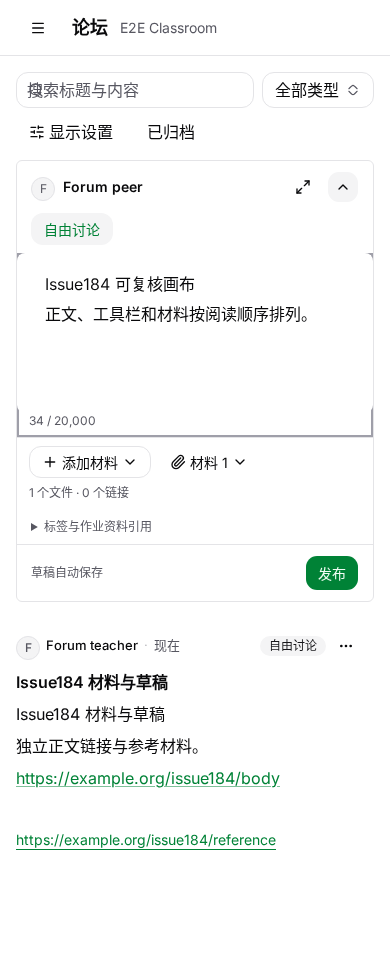

# Same-viewport comparison

The fixtures publish the same representative case records and the same Issue184 forum post/draft. The before captures remain immutable. Generated IDs and relative times vary. See [AUDIT.md](AUDIT.md) for tasks and [ACCEPTANCE.md](ACCEPTANCE.md) for commands and limits.

| Case list · 1440×1000 · before | After |
|---|---|
|  |  |

The same two titles and summaries are visible from y≈183 instead of y≈547. Blank artwork and promotional text no longer displace the actual list; existing search/category controls, optional uploaded thumbnails and author actions remain.

| Case list · 390×900 · before | After |
|---|---|
|  |  |

The category selector retains visible keyboard focus; rows remain a single column without document overflow.

| Forum · 1440×960 · before | After |
|---|---|
|  |  |

The existing sections and filters share the top area; the date calendar opens on demand. The first post follows the compact composer instead of a permanent calendar column and several filter rows.

| Forum editor · 390×960 · before | After |
|---|---|
|  |  |

The body is the complete official native editor. Materials, reference links, tags and publication retain their business controls. More focus/material/dark states are alongside these images; native narrow-screen formatting controls are in [after/native](after/native).

The forum material fixture contains the same 1×1 transparent image as the original before run. Its reserved image area is retained content, not a new decorative spacer. Screenshots use the existing fixture unchanged so the layout comparison remains reproducible. Raw reports preserve the runner artifact paths; committed images are alongside each report under their original screenshot leaf names.
