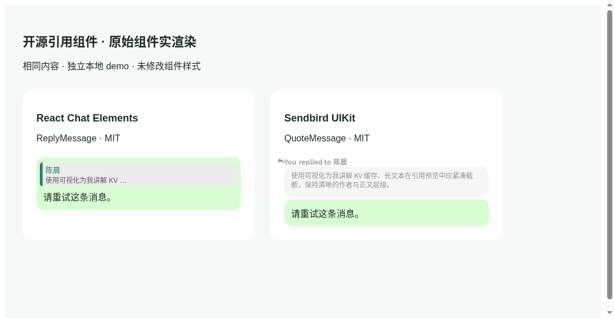

# #302 quoted reply preview

The user's diagnostic image was inspected privately. It is not included here.
Every PNG in this directory uses synthetic local messages and test identities.

## Root cause

This is a rendering/cascade regression, not a missing stylesheet or missing
Tailwind build output:

1. `ConversationMessage.QuotePart` rendered a generic `Button` as a sibling
   above `NativeMessageContent`. Human bubble chrome belongs to `MessageTextPart`,
   so the quote occupied a separate 448px row outside the right-aligned bubble.
2. The Button base contributes `border` (1px on all sides). The quote's
   `border-primary/60` changes every side's color, while `border-s-2` only makes
   the start edge thicker. `rounded-none` explicitly removes corners. It has
   no background. The retained `.openmaus-quote-card` rules are not used by this
   renderer. `chat.css` is imported from `globals.css` normally.
3. The unlayered global `button { font: inherit }` overrides layered Tailwind
   `text-xs`. The real computed size was 16px despite the class being present.
4. History projection used `nativeText` only, so an attachment-only original
   never supplied its filename/author to an otherwise valid quote.

The baseline browser measurement is in [before-metrics.json](before-metrics.json):
0px corners, 1/1/1/2px border, transparent background, 448px width, outside bubble.
The fixed component has 10px corners, only a 3px start edge, a tinted surface,
12px author + 13px summary and 16px unchanged message body. Human text quotes are
inside the first bubble, exactly once; assistant/media-only quotes stay beside
their existing body/card. Composer previews use the same component and resolve
history identity without downloading quoted media.

## Actual upstream comparison and direct reuse



| Candidate | Inspected code / license | Local demo |
| --- | --- | --- |
| [React Chat Elements ReplyMessage](https://github.com/Detaysoft/react-chat-elements/tree/f487e7e83320bee8b74ac758d17f1ad418343173/src/ReplyMessage) | MIT, Detaysoft, source commit `f487e7e83320bee8b74ac758d17f1ad418343173` | npm `react-chat-elements@12.0.18`, gitHead `3ac4b02aa2cfc076f77293eb638a4ec842d995f7`; ReplyMessage TSX is byte-identical at both commits |
| [Sendbird UIKit QuoteMessage](https://github.com/sendbird/sendbird-uikit-react/tree/08e0a2cbc5fd542863c7fada0c1e8dc204f69786/src/ui/QuoteMessage) | [MIT](https://github.com/sendbird/sendbird-uikit-react/blob/08e0a2cbc5fd542863c7fada0c1e8dc204f69786/LICENSE), Sendbird; inspected source commit `08e0a2cbc5fd542863c7fada0c1e8dc204f69786` | npm `@sendbird/uikit-react@3.20.0`, gitHead `ac72d55038ca2f6dab18bdd61e3433609f1d62c9` |

The screenshot renders the actual shipped React components and their original
CSS in two neutral demo frames. RCE was selected for its compact, embedded
WhatsApp-style author/text/left-edge layout. Sendbird's separate low-opacity
bubble needs more space and its component imports SDK-specific utilities.
RCE's standalone source is only 31 lines plus a small stylesheet. We vendor
that source, preserve its owner/text hierarchy and import its original CSS,
with explicit scoped styling and semantic button adaptations. No new runtime
package, SDK or chat framework was added. See the full upstream snapshot,
[license](../../../third_party/react-chat-elements/reply-message/LICENSE) and
[adaptation notes](../../../third_party/react-chat-elements/reply-message/README.md).

## Validation and reproduction

Run `npm ci --ignore-scripts` at the repository root, matching CI. A separate
server install is not needed for frontend checks.
This environment initially had a missing MCP UI dependency and stale **installed**
server runtime 3.5.2 despite both locks requiring 3.8.0; reinstalling from existing
locks fixed those local setup failures. No manifests or locks changed.

```
E2E_TELEMETRY_DISABLED=1 node node_modules/e2e/dist/cli/bin.js run --config e2e.quote-preview.config.ts
E2E_TELEMETRY_DISABLED=1 node node_modules/e2e/dist/cli/bin.js run --config e2e.chat-213.config.ts
npm run lint
npm run build
npm test
```

The browser suite uses official `@e2e-dev/web` through `e2e` (no direct Playwright).
Set `E2E_CDP_URL` only when using an already running local Chromium. It exercises
the real ConversationThread/composer/history converter; the fixture replaces
only the final IM send boundary. It verifies quote serialization, not live IM or
production delivery. Screenshots and computed geometry are repeatable artifacts.
No production MCP, account, LLM or deployment was accessed.

The 1280px/390px cases cover self/incoming/assistant quotes, history snapshots,
multi-part duplication, long text, files, unavailable originals, keyboard jumps,
repeated activation, cancel/focus return, sending and replay. Mobile verification
caught the existing fixed-bottom scroll button covering quote dismiss; the button
now lives at the reading area's bottom, above a composer of any height.

To reproduce the upstream comparison, copy `e2e/quote-preview/research-demo.jsx`
into a temporary directory outside the app; install the two exact versions above
plus React 18.3.1, ReactDOM 18.2.0 and esbuild 0.28.2 there. Bundle `demo.jsx` with esbuild
(`--bundle --outfile=demo.js --loader:.svg=dataurl`), serve an `index.html` loading
`demo.css`, `demo.js` and `<div id="root"></div>` on localhost:5193, then run
`node node_modules/e2e/dist/cli/bin.js run --config e2e.quote-candidates.config.ts`.
These research-only packages must not be installed into the app.

## Delivery boundary

Draft PR only. No merge or deploy; integration belongs to the task designated by
the user. Changes exclude #295 diagnostic text, #296 trace, #297 models and #298
runtime logic. The only history change is attachment quote summary enrichment.

## Screenshots

[Before desktop](before-desktop.png) · [After desktop](after-desktop.png) ·
[Dark desktop](after-dark.png) · [Mobile composer](after-mobile-composer.png) ·
[Dark mobile](after-mobile-dark.png)

The original browser report is [browser-report.json](browser-report.json).
The report records 2 passed, 0 failed, 0 skipped viewport cases.

## Independent review follow-up

Read-only review found and verified two corrections: composer text supplied by
reply actions remains authoritative even when intentionally empty (hidden
citations must not reappear); unavailable/tool-only placeholders stay in the
view rather than cached quote metadata, allowing later source text to resolve.
Both have explicit E2E cases; the refreshed report includes them. The original
scroll/mention suite also passes 3/3 after the scroll-button move.

Additional attempted gate: repository-wide `npm run test:e2e:typecheck` exposes
existing OpenAI/Zod incompatibilities in untouched `e2e/forum/api.ts`,
`server/src/agent-runtime/activity-tool.ts` and `server/src/im/router.ts` when
both existing lockfiles are installed (root OpenAI 6.37.0/Zod 4.4.3 versus server
OpenAI 6.49.0/Zod 4.5.4). The quote tests/configs and fixture pass their scoped
TypeScript checks. No package manifest, lock or runtime version was changed to
work around this unrelated gate.

## Integrator regression correction

Independent review of `7ac5f406` found that importing the two CSS files directly
from `ReplyMessage.tsx` breaks the existing Node/tsx `ConversationMessage.test.tsx`
suite with `ERR_UNKNOWN_FILE_EXTENSION`. The prior green Web smoke selection did
not include this unchanged renderer suite. The failure was reproduced before the
correction.

Both stylesheets now load, in the same upstream-then-adaptation order, from the
existing global CSS entry. Their bytes and the MIT source snapshot are unchanged.
The existing 16-test renderer suite is now part of ordinary Web smoke selection;
no renderer is mocked away and no test loader or test assertion is weakened.

The corrected renderer suite passes 16/16, ordinary Web tests pass 82/82, and the
official desktop/mobile quote browser cases pass 2/2 after the CSS entry change.
These include real quote geometry, keyboard interaction, cancellation, send and
replay, alongside renderer coverage for answers, RunActivity and actionable
errors. Local integration report: `integration-browser-report.json`.

The integrator's production build (including Web typechecks) and full
`npm run test:e2e:typecheck` pass with the root-only dependency layout used by CI.
This is a new successful check in the selected environment; it does not rewrite
the earlier worker's duplicate-dependency failure. No lock or package manifest
was changed to obtain this result.
