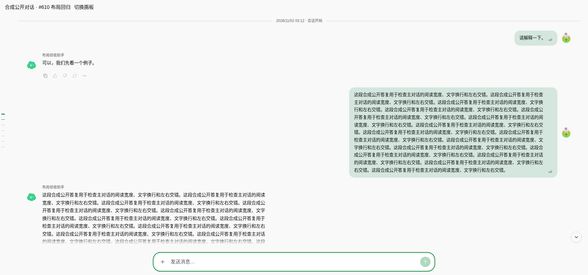

# #610 — shared conversation reading width

The 1920×900 baseline reproduces the reported separated lanes: the transcript
spans 1866px, while each message content area stops at 800px. The long human
bubble begins 206px after the Agent content ends. The source already uses one
row per message; this is not a two-column message grid.

The fix caps the shared message column at the existing composer's 960px reading
width and centers it. The 800px per-message cap, alignment, DOM order, avatar and
bubble treatment remain intact. At 1920×900, the Agent still has 800px of content
width and now overlaps the human bubble's horizontal range by 677.6px. Narrow
containers remain fluid. No changes to ChatPane, DesktopApp, DesignWorkspace,
message rendering, SDK, transport or scroll ownership.

## Reproduction and measurements

Base: `3cbc78d8` (SDK 3.8.21). Cloud Chromium, synthetic public messages and local
API responses. Fixture uses the real ConversationThread, ConversationMessage,
composer, Markdown/code/Mermaid renderers and DesignWorkspace/resizable panels.
The design editor grant is replaced with `about:blank`; the editor's service and
content are outside this regression. No production account, private messages or
production data were used.

Run Vite with `npm run dev -- --host 127.0.0.1`, then:

```sh
PLAYWRIGHT_MODULE=/opt/codex/cua_node/lib/node_modules/playwright-core/index.mjs \
LAYOUT_OUTPUT=/tmp/610-evidence node docs/evidence/issue-610/check.mjs
```

`PLAYWRIGHT_MODULE` and `BROWSER_EXECUTABLE` may point to another installed
Playwright/Chromium. `LAYOUT_BASELINE=1` records the old layout without expecting
the new column bounds. Before implementation, the normal regression failed at
`1920/full: unbounded reading column`.

| Viewport | Before column | After column | After Agent width |
| --- | ---: | ---: | ---: |
| 1920×900 | 1866px | 960px | 800px |
| 1280×900 | 1226px | 960px | 800px |
| 768×900 | 714px | 714px | 621.2px |
| 390×900 | 380px | 380px | 308px |
| 320×900 | 310px | 310px | 238px |

All 30 final observations passed: five widths × full conversation, code/diagram,
actual design open, actual design close, resize at bottom, and reading-anchor
checks. The replay asserts no page/transcript horizontal overflow, preserves all
16 message identities, retains the actual viewport DOM through design toggles,
retains selected code, bounds its anchor displacement to two lines (56px),
keeps bottom-follow intent after resize, and accepts typed input. Short and long
text, multiple turns, a native tool record, a PDF attachment, a long unbroken code
line, a table and a rendered Mermaid SVG are present. Browser page errors: zero.
Observed anchor displacements after an open/close round trip were 0, -50, -25,
0 and 0px at 1920, 1280, 768, 390 and 320px respectively. The check does not claim
pixel-exact reading position through reflow.

Raw results: [before.json](before.json), [after.json](after.json).

| Viewport | Before | After |
| --- | --- | --- |
| 1920×900 |  |  |
| 390×900 |  |  |

Rich content: [1920×900](after-rich-1920.png), [390×900](after-rich-390.png).

## Checks and remaining gates

- `npm run lint`: exit 0, existing repository warnings.
- `npm test`: 130 passed, zero failed.
- `npm run build`: passed, including both Web TypeScript projects, visualization
  verification/build and production Vite build; existing dependency/CSS warnings.
- `git diff --check`: passed.

The focused browser result establishes local layout behavior, not production
acceptance, editor-service correctness or live GenUI guest persistence. Those
services and physical-device testing were not replayed. Independent review of
the frozen candidate and integration/release remain with the designated parent
integrator. No merge, deployment, SDK publication or PR Approve was performed.
