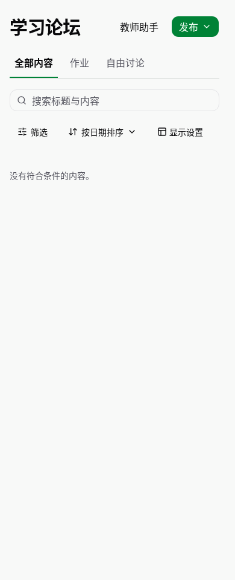
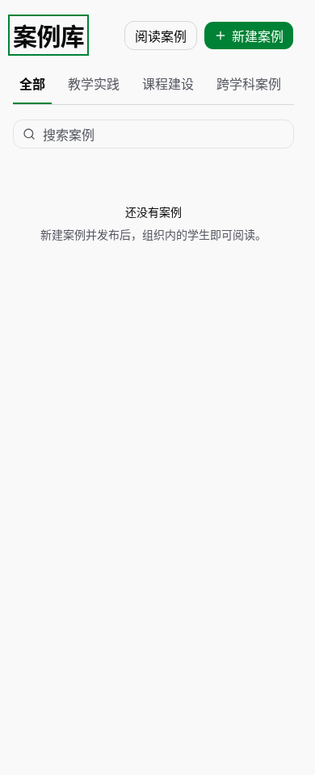

# Shared learning page navigation and forum publication

Refs #470, #472. Production changes are limited to page headers/navigation and
forum creation presentation; material preview and avatar components are untouched.

- Forum, materials and cases now import the same `LearningPageHeader` and
  `LearningTopTabs` source and design tokens. Their title edges, font/weight,
  header right edge and tab baselines match at 390, 768 and 1440px. Real category
  filters scroll horizontally and support Arrow/Home/End keys. Search/filter
  controls sit below the tabs; authorized upload/create actions sit at the top.
- The default forum feed mounts no composer or placeholder. Teachers use the
  top-right Publish menu (discussion / formal homework), and authorized students
  get discussion publication. Existing discussion editing remains available.
- Discussion dialogs reuse `ForumComposer` and its scoped draft/attachment/error
  handling. Course/account changes unmount the old dialog. Formal homework uses
  the existing `HomeworkComposer` draft, validation and human publish lifecycle.

## Necessary checks

[Official browser results](browser-summary.md): final **5/5 passed**, covering
discussion close/reopen draft preservation, course isolation, one discussion and
one formal homework publish/readback, student/readonly action boundaries, public
versus private material upload capability, three-page geometry at the requested
widths, and keyboard selection/scrolling of the final real case category.

The forum-only baseline regression failed because an editor was already mounted
on the default homepage. After implementation all five scenarios passed. The
final run added keyboard/material-permission assertions without broadening the
product scope. [Commands, attempts and source hashes](checks.json) are retained.

`npm run build` (including web typecheck), fixture typecheck, focused lint and
`git diff --check` passed. Existing formal-homework and web-forum acceptance
selectors were updated for the new header menu; those full suites were not run.

The browser exercises real components against isolated synthetic HTTP responses;
its formal homework validation receipt is synthetic. This is frontend acceptance,
not a claim of production/model-provider acceptance. No server/permission policy,
migration, dependency, mail workflow, preview or avatar implementation changed.
After main merged #482, the adjacent cases CSS conflict was resolved by retaining
its stable scrollbar gutter alongside the shared container names. The affected
five browser scenarios and production build passed again; captures and source
hashes reflect this rebased candidate. The draft PR is for the designated sole
release environment to integrate.

## Captured 390px pages

