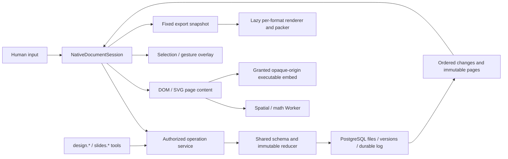

# Native Design / Slides implementation record

This records the implementation and the evidence available before the final
candidate commit. It is **not a completed acceptance report**. The frozen source
is `d004312841026a4d90dfbd9e8292a55cc29a2e95`; the working branch is
`codex/shared-artifact-editor`. The [measurement record](README.md) owns the fixed
50-page inputs, hashes, cold-start protocol and outstanding performance gates.

The user subsequently authorized upgrading the candidate to the published
`@lingxi-org/lingxios@4.0.0`. The dependency and explicit provenance bridge are implemented;
the original `@lyyzka/lingxios@3.8.25` baseline remains frozen. Package access
remains unavailable locally for both releases. CI installed the formal 4.0.0
package successfully. CI run [41973257639](https://github.com/LingXi-Org/LingxiLoop/actions/runs/41973257639) passed the web checks/build, server typecheck and formal bootstrap/migration, then failed server unit and integration checks. The outdated server authoring-guidance test was corrected in `c18fc571`; integration is still under investigation. Consequently the complete authenticated app, owning runtime
integrations, live Agent conversation and paired performance runs remain
unverified. Public dependencies were installed at their lockfile versions for
isolated checks and browser builds. No replacement SDK or fake runtime is
counted as acceptance. Results below that predate the SDK upgrade cannot qualify
the new migration, assembled harness or runtime without an owning rerun. The
[SDK upgrade audit](runtime-4.0.0.json) records publication/source evidence and
the remaining package-execution gates.

## Architecture and references

The implementation uses the existing React/TypeScript stack. The references
informed boundaries and data flow; their editor frameworks were not imported:

| Reference | Applied boundary |
| --- | --- |
| [PPTist page model, `a8fcb4d`](https://github.com/pipipi-pikachu/PPTist/blob/a8fcb4d92194678988bb1238bf7ac33f2e0baeaa/src/types/slides.ts) | Stable page/node data, partial operations, current-page rendering |
| [Excalidraw renderer, `7ded689`](https://github.com/excalidraw/excalidraw/blob/7ded689cad49331167e29fd88b38f38d3736d576/packages/excalidraw/scene/Renderer.ts) | Separate content and interaction layers; viewport filtering |
| [Penpot Worker index, `eb9594a`](https://github.com/penpot/penpot/blob/eb9594a614b986b3df73b202f9a2dcd94511c5cd/frontend/src/app/worker/index.cljs) and [exporter](https://github.com/penpot/penpot/blob/eb9594a614b986b3df73b202f9a2dcd94511c5cd/exporter/README.md) | Revisioned computation messages and export independent of mutable editor state |



The main source boundaries are:

| Boundary | Owning files |
| --- | --- |
| Data, validation and reducer | `shared/artifact-document.ts`, `artifact-operations.ts`, `artifact-check.ts` |
| Native UI, local queue and transport | `src/features/artifacts/native/{NativeEditor,renderer,RichTextEditor,session,transport}` |
| Persistent operations and history | `server/src/modules/artifacts/{native-document,native-history,native-projection,native-router}.ts` |
| Agent contract and completion evidence | `server/src/modules/artifacts/{agent-tools,contracts,native-reference,check}.ts` and `server/src/agent-runtime/{context,skill-context}.ts` |
| On-demand legacy conversion | `shared/artifact-legacy.ts`, `server/src/modules/artifacts/native-conversion-worker.mjs` |
| Export | `src/features/artifacts/native/export-artifact.ts` and `export/` |
| Migration and activation | `0063_native_artifact_documents.sql`, `deploy/harness-cutover.mjs`, `server/src/db/harness-cutover.ts` |

## Canonical data and operation contract

`ArtifactDocument` contains `schemaVersion: 1`, stable ID, Design/Slides mode,
title, monotonic `seq`, theme selection, themes, assets, page order, pages and
version tokens. Each page contains its position, dimensions, title, background,
notes, skip/transition information and ordered nodes. `sizing` distinguishes
fixed and flow boards; `paper` retains A4, Letter or custom sizing. Nodes support
typed rich text, raster images and normalized crops, shapes, lines, tables, SVG,
TeX formulas, groups with absolute/flex/grid layout, and isolated source blocks.
Selection, viewport, gesture previews and measurement state are not document
history.

The persisted native files are `project/document.json` and
`project/pages/<id>.json`. The manifest indexes pages and immutable content
hashes. A commit updates its affected page files and the manifest, while
unchanged pages keep their hashes. Existing artifact ownership, assets,
comments, revisions and content-addressed file versions remain in use. LingxiOS
shared state does not store the editor document.

The public batch shape is:

```ts
{
  operationId: string,
  baseSeq: number,
  expectedVersions: Record<string, number>,
  operations: ArtifactOperation[]
}
```

`prepareBatch(document, operations, operationId)` derives preconditions from the
observed state. `applyOperations(document, batch)` returns an immutable document,
inverse operations, changed page IDs and changed version keys. The pure reducer
does not own user identity, idempotency receipts or the durable undo stack.

| Operation family | Concurrency condition |
| --- | --- |
| `document.patch`, `page.patch`, `node.patch` | Touched field versions and object existence generation; individual style fields are independent |
| `page.insert`, `node.insert` | Object absence/generation and relevant collection/dependency versions |
| `page.delete`, `node.delete`, `node.replace` | Aggregate object version, including descendant changes |
| `pages.reorder`, `nodes.reorder` | Collection version |
| `theme.set/delete`, `asset.set/delete` | Resource version and affected selection/reference dependencies |

An old document sequence can still modify a different current field. A stale
same-field edit rejects the entire batch before mutation. Deleting or replacing
an object invalidates previously observed edits, including edits to previously
absent fields. Group and page deletion check descendant changes. Asset deletion
cannot race a newly added reference. Inverses restore content while sequence and
version tokens continue to increase; deletion generations remain as tombstones.
For text nodes, a plain `text` patch without `richText` replaces both visible
representations: it clears rich text and requires its field version, even if it
was absent. A plain page `background` patch similarly clears its semantic theme
binding and checks that binding's version. Explicitly supplying both fields
retains the requested representation/binding. Undo restores the exact prior
content and references.

The server serializes document commits under an artifact row lock. An operation
ID with the same request returns its durable receipt; reusing it for a different
request fails. The log persists operations, inverses, actor and result. Shared
undo/redo checks both the target operation and history version, includes Agent
batches, and clears redo after a new edit. Redis only wakes listeners; ordered
PostgreSQL changes are the reconnect source.

The browser holds committed state and an optimistic queue. Retry preserves the
request ID. It only rebases unsent dependent edits over its own acknowledged
changes. Conflicts retain queued edits and later drafts for recovery download;
they do not silently overwrite the server. Pending edits are an in-memory queue,
not a claim of durable browser storage. Ctrl+S flushes the queue; the saved state
requires an acknowledged commit. Text grouping flushes after composition/idle
or blur, and gestures commit once on completion.

## Read/write API and Agent behavior

All routes are under `/api`. Existing permission and assignment checks remain
at the request/tool boundary.

| Interface | Contract |
| --- | --- |
| `GET /artifacts/:id/document` | Manifest/page headers, first loaded page by default, immutable page hashes, version tokens and history; explicit page selection is supported |
| `GET /artifacts/:id/pages/:pageId?hash=<sha256>` | A fixed page version, with private immutable caching when pinned |
| `POST /artifacts/:id/operations` | Versioned partial batch, or versioned shared undo/redo; returns committed sequence, changes and history |
| `GET /artifacts/:id/changes?afterSeq=<n>` | Durable ordered changes after a known cursor |
| `GET /artifacts/:id/changes/events` | SSE notifications backed by the same log, with authorization rechecks |
| `GET /artifacts/:id/source` | Downloadable JSON source archive, including retained originals/resources |
| `design.*` / `slides.*` | `read_document`, `read_page`, `apply_ops`, with existing artifact assignment scope |

Agent page reads take both `version=pageVersions[pageId]` and `atSeq=document.seq`.
The service verifies that the hash belonged to that snapshot and returns only
the relevant page/field versions. This avoids combining old page content with
current preconditions. Agents read the native authoring reference and submit
partial operations; direct native manifest/page writes are fenced. Title
updates, theme installation and revision restoration use the operation service.

The structural checker validates schema, references, ordering, parent graphs
and payloads. It does not execute HTML or compile formulas. Authored completion
requires successful writes and checked, indexed, nonempty native page paths.
A failed CAS, removed path or blank newly created page cannot prove completion.
Isolated content produces an advisory about its editing limits rather than
claiming that its execution or appearance was checked.

## Rendering, computation and export

Slides mounts its current page. Design uses Worker-maintained page and element
indexes to mount visible content, and requests page contents on demand. Active
editing/selection ancestors and complete flex/grid subtrees stay mounted so
culling does not change their layout. Navigation uses a virtual list with cached
compact SVG previews, bounded to 128 entries/2 MiB and 96 nodes per preview.
Unvisited pages use a neutral preview until loaded. Preview images are separately
downsampled; thumbnails do not mount hidden editors or iframes. Content is
memoized separately from selection handles and
gesture previews. Pointer motion changes transient interaction state; the
document changes at gesture completion. Unmounted images abort loads and revoke
object URLs. Active rich text loads the existing Tiptap/ProseMirror integration
on demand; inactive text uses a safe typed renderer.

The UI implements text/table editing, geometry, drag/resize, multi-selection,
copy/paste, grouping, ordering, alignment, image replacement/crop, TeX source,
theme selection, page ordering, notes, and keyboard presentation navigation.
Flow layout measures DOM content and persists its resulting page geometry.
Chinese physical IME behavior and all presentation build/transition scenarios
still require the owning browser acceptance run.

Computation messages contain a request ID and document revision, support
cancellation, and discard stale results. The browser Worker owns spatial index,
visibility/snap calculations and KaTeX generation with `trust: false`; math
caches are bounded. Geometry batch validation and theme-alias resolution also
run there. Canonical operation validation remains enforced in the shared reducer
and server. Legacy parsing uses an on-demand Node Worker. DOM layout,
font measurement and capture remain in renderer code. PDF/PPTX packaging runs
in separate lazily loaded Workers.

Exports consume a cloned fixed snapshot, load formats on demand, resolve assets
with the existing authorization path, and render/release one page at a time.
They expose progress and cancellation without changing the editing snapshot.

| Format | Implemented representation and remaining qualification |
| --- | --- |
| HTML | Offline asset/font packing; isolated executable blocks become fixed preview images with explicit interaction-loss warnings. Direct `file://` opening is blocked by this browser environment, so offline opening remains unverified. |
| PDF | Page captures plus Chinese-capable text layer and links; flow pages split by selected paper ratio. A 50-page PDF and Chinese text extraction were verified. Representative-page fidelity and flow text selection/link placement remain to inspect. |
| PPTX | Ordinary text, shapes, tables and notes retain native objects; formulas and complex nodes use reported image fallbacks. All 50 slides, notes and native objects were inspected; LibreOffice rendered 50 pages, with visual inspection of pages 1, 25 and 50. Formula/complex content uses explicit raster fallbacks. |

Element culling, previews and theme Worker work were added after the first
production-bundle smoke. The later focused checks cover their contracts, but
their final production build and full-app memory/feedback results must still be
recorded. Cached compact SVG summaries are not full screenshot thumbnails.

## Legacy preservation and isolation

Conversion recognizes the retained canvas/deck formats and declarative content.
Unsupported source becomes an explicitly isolated HTML/JSX block. Parsing never
executes that source. Read-only opens can compute an ephemeral conversion;
persistent conversion requires write authorization and a compare-and-swap check
of the original file listing. That transaction records original file and stored
asset hashes, stores the separate native representation, and starts its history.
Original bytes remain available and hash-verified after editing/restoration.
Unknown native schema versions reject editing and retain source recovery.
Isolated nodes can pin `resourceVersion` to an immutable `local-<16 hex>` source
checkpoint so restoring earlier HTML/JSX does not resolve its CSS/children from
the first-converted version. The server verifies resource ownership and hashes.

Native rich text has a constrained tree and safe links. Native SVG uses a
balanced, whitelisted XML subset, excluding event handlers, foreign content,
external references and executable constructs. Executable source does not
become arbitrary native DOM. Granted iframe content uses `sandbox="allow-scripts"`
without `allow-same-origin`, with scoped grants and a constrained capture
protocol. HTML/JSX and DC compatibility handling belongs to the small independent
adapter, not an archived editor implementation; its latest runtime cases need
their own reported test result.

The six retained theme looks keep source attribution and original token data.
Optional `theme.resources` stores original CSS/HTML/JSON/Markdown sources as
inert authoring metadata: safe relative paths, at most 30 files, 2 MiB UTF-8 per
file and 4 MiB total. The native renderer does not execute these resources.
Theme updates and their inverses preserve the exact strings. New pages, text,
formulas, tables and shapes bind semantic background/text/font/accent roles.
Shared helpers map the retained palette names to those roles, including
surface/ink/ember and ivory-warm/slate/clay. Explicit authored styles remain
overrides; custom background edits clear their binding. A theme selection can
therefore change default content without rewriting every page, and undo restores
the previous appearance. Fixed legacy colors remain fixed during conversion.

Retirement removes the old editor UIs, runtimes, compiler/build scripts, bridge,
preload and Docker asset-retention paths. The retained baoyu manifest covers 303
static design-rule, theme, format, template and license files with hashes. Source
checks verify required resources and absence of executable editor paths. A final
image and full-app network inventory are still necessary to prove the shipped
artifact matches this source-level removal.

## Migration and release boundary

Migration `0063_native_artifact_documents.sql` adds native state/log tables and
copies editor context. It does not eagerly convert saved drafts. The initial
release checks covered product62 → product63 with an unchanged LingxiOS 3.8.25;
the now-authorized 4.0.0 upgrade additionally requires an explicit provenance
bridge and new qualification. The migration owner reports matching published
database schema files, which does not by itself qualify runtime compatibility.
The Agent harness contract changes, so deployment must compare the actual
assembled target receipt with both Web and both Worker slots, drain pinned work,
and apply the documented exclusive barrier before target convergence. The
[release procedure](../../RELEASE.md#native-designslides-product63-cutover) owns
the updated package/provenance gates and compatible recovery. Those final fields
and results are pending; no deployment is asserted here.

`NATIVE_ARTIFACT_WRITES_ENABLED` defaults to false in production and both Compose
stacks. All Web/Worker instances must support the new protocol before activation.
After conversion, legacy whole-file publication returns a refresh/recovery
error. Original bytes and native history cannot be replaced by restoring an old
editor format. A rollback after native writes requires a release that understands
the native format.

## Checks actually run

These are focused implementation results reported by the owning contributors,
not a final-candidate aggregate. Counts overlap across commands. Rerun affected
checks after final edits and attach the final commit and independent review.

| Check | Observed result and scope |
| --- | --- |
| Shared checker/reducer | 26 passed: 21 reducer cases plus 5 checker cases, including field concurrency, atomic rejection, descendants, resource races, monotonic inverses, retained theme resources, actual retained light/dark defaults and plain-text/rich-text replacement. Standalone strict TypeScript and focused Biome passed. |
| Native SQL service | 11 passed against real PostgreSQL using actual 0063 DDL in an isolated schema with minimal owning tables; covers 50-page persistence/hashes, immutable reads, conflicts/retry, original bytes, history, source-version conversion guards, unknown schema immutable historical resource checkpoints and strict native manifest/page file reads. This is not the full formal-runtime migration/auth API integration. |
| History/projection and storage | 3 history/projection cases and 4 storage-provider cases passed. |
| Browser session/compute/assets/capture/preview | 25 focused native UI/session/compute/draft/capture/preview cases passed, including Worker element indexes, theme alias work and preview bounds. |
| Legacy/embed/export units | [17 passed](conversion-export-tests.txt), including DC shape/grid/print conversion, DCLogic registration, inline formulas, semantic themes, static isolated previews and invalid assets. |
| Browser editor smoke | [Isolated UI report](isolated-ui-smoke.json): Chromium + React StrictMode, controlled HTTP reducer fixture; all 50 Slides pages and all 50 Design artboards visited with images/formulas; at most one Slides page or four visible Design artboards mounted; trusted text edits/save/reload on pages 1/25/50, formula and crop edits, theme/order changes, shared undo/redo including an injected Agent batch, and interaction with page 25’s isolated content; 47 untouched page payload hashes remained unchanged; a plain-text injected remote operation appeared through polling. Dense Design culling, active-editor retention, theme changes and presentation navigation passed. CDP Chinese composition saved once after commit and never during pauses; native OS IME remains unverified. Focused Ctrl+S tests hold server acknowledgements and verify draft→pending→saved state for properties, table cells and notes. This does not exercise product auth, PostgreSQL or a live Agent. |
| Isolated DC browser smoke | [Compatibility report](isolated-compatibility.json): Chinese props, loops, click/state/conditional behavior, immutable child import, installed component/CSS, blocked `parent.document`, wrong-nonce rejection, and 30,546-byte PNG captures including one waiting for a delayed child. No browser errors. This remains separate from authenticated product-origin acceptance. |
| Candidate browser bundle | CI full web checks and production build passed at `d436a421`. The production [static dependency audit](bundle-graph.json) verifies that the app, native editor and active text editor do not statically import compatibility/export code, and the separate export HTML does not preload the app. It records the exact source-input fingerprint. The public-only local build cannot qualify the full SDK-dependent typecheck or actual browser network loading. |
| Export browser run | [Export report](export-acceptance.json) owns file sizes/hashes, independent PPTX renderers and visual/media inspection. Real Chromium rendered a production-bundled 50-page snapshot; PDF tooling verified 50 pages and Chinese headings 1/25/50. [Fault checks](export-faults.json) verified mid-export cancellation/retry for all formats, image HTTP 503/retry, export HTML entry failure, adapter/shared/inner module failures, and cancellation during active packing-Worker loading. All retries run in the same window using fresh trusted renderer realms; snapshots stay immutable and renderer/Worker counts return to zero. |
| Retirement/release source checks | `harness-cutover` + CI-scope: 20 passed in the latest reported run. Earlier `harness-cutover` + runtime-patch + retirement: 35 passed. Compose config, deploy CLI syntax and diff whitespace checks passed. These do not qualify a built image or actual SDK receipt. |
| Agent authoring fixtures | Updated for `read_document`/pinned `read_page`/`apply_ops` and failed-CAS completion guards. Syntax/Biome passed. CI run41976017829 at `c18fc571` passed the complete server unit/typecheck job after the observation/guidance correction. Its integration suite failed the native Design failure scenario; the owning test is being diagnosed, while stale legacy-write fixtures and the 62-file selected-suite timeout were corrected. Runtime/live-model qualification remains incomplete. |
| Frozen baseline and fixed fixture | See [baseline-build.json](baseline-build.json), [fixture-test.txt](fixture-test.txt) and [baseline startup blocker](baseline-service-blocker.txt). Static sizes are not cold-start/transfer/memory measurements. |

The evidence files above preserve selected results and screenshots. Larger
export files remain under `/workspace/scratch/native-export-acceptance/`.
Fixture version 2 adds the isolated block to page 25. Both 50-page UI diagnostics
and all three 50-page exports were rerun using its semantic hash. They remain
isolated functional evidence, not authenticated-app or performance acceptance.

## Reproduction and outstanding acceptance

With the exact dependency installation available, the focused commands are:

```sh
node --import tsx --test shared/artifact-check.test.ts shared/artifact-operations.test.ts
node --import tsx --test src/features/artifacts/native/*.test.ts src/features/artifacts/native/thumbnail.test.tsx
node --import tsx --test shared/artifact-legacy.test.ts server/src/modules/artifacts/native-embed-source.test.ts src/features/artifacts/native/export/export.test.ts
node --import tsx --test server/src/modules/artifacts/{native-history,native-projection}.test.ts
node --test scripts/native-artifact-retirement.test.mjs deploy/harness-cutover.test.mjs deploy/runtime-patch.test.mjs
node scripts/native-export-acceptance.mjs /workspace/scratch/native-export-acceptance
node scripts/native-export-fault-acceptance.mjs /workspace/scratch/native-export-acceptance/export-faults.json
node --import tsx scripts/native-embed-acceptance.mjs /workspace/scratch/native-embed-acceptance
```

The SQL service test requires an explicitly supplied loopback test database;
it creates and drops only its isolated schema:

```sh
node --import tsx --test server/src/__integration__/native-document-service.test.ts
```

The owning full integrations require the formal runtime and dedicated test
PostgreSQL/Redis configured through the existing integration runner. That runner
truncates its dedicated database and must not target product data:

```sh
npm run test:integration -- --file native-artifact-documents-migration.test.ts
npm run test:integration -- --file runtime-first-action-contracts.test.ts
npm run test:integration -- --file runtime-design-failure.test.ts
npm run test:integration -- --file runtime-slides-generation.test.ts
```

Live Agent qualification also needs the explicit existing live-test
configuration and an authorized real model; deterministic fixture conversations
are not a substitute.

The complete release remains unqualified until both modes pass the performance
gates in [README.md](README.md), and the actual product verifies pages 1/25/50
editing, durable reopen, shared undo/redo, theme/order changes, Agent collaboration
and disconnect/ack-loss recovery. Outstanding evidence includes cross-tenant and
revoked-permission HTTP behavior, simultaneous client undo, malicious source
isolation in the real granted origin, conversion/edit/restore hash checks through
the product, offline HTML, final image/dependency/network inventory, final frontend/backend
checks and independent review. Passing the isolated tests above does not waive
any of these gates.
