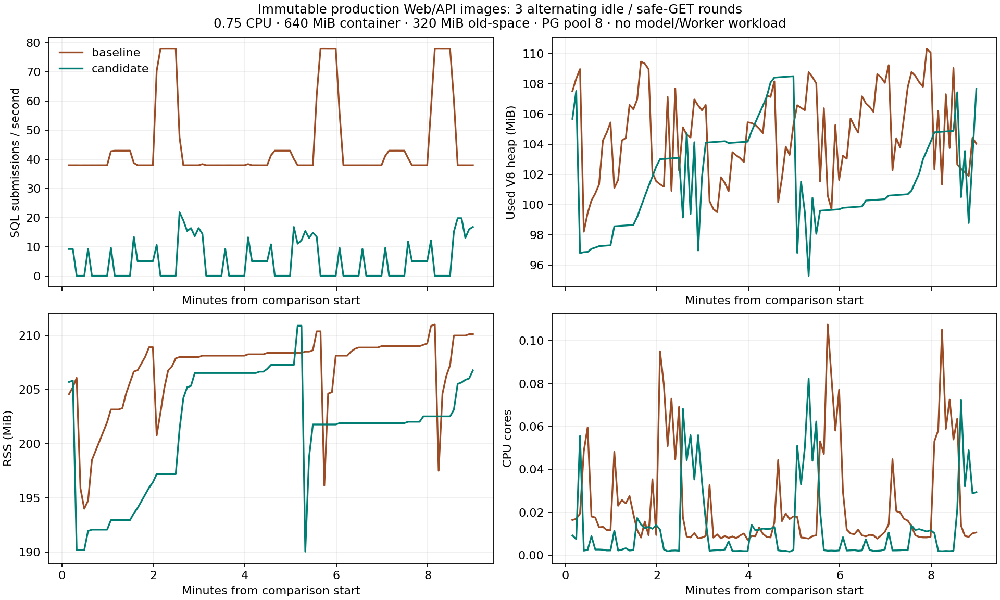

# Runtime acceptance, measurements and continuation

This batch records **10/10 official browser checks**, an 18-phase paired
Web/API comparison, private heap-profile aggregates and the start of a
24-hour isolated Web/API observation. It does **not** establish live-provider,
production Worker, production rollout or completed 24-hour acceptance.

## Versions and immutable images

The browser matrix ran product `c3abc92640cf96feb42dd2b8b307df9c73b9d2e3`
(merged PR172) with harness `1dc9a67333de5444a7acc268f6baa0e42eff55d3`.
PR171 fixed the independent server manifest/lock and Docker package assertion.
The exact public package is **@lyyzka/lingxios 3.5.1**, schema **12**; no
vendored implementation or private runtime import is used.

The paired measurement uses immutable server images, both limited to 0.75 CPU,
640 MiB memory, 320 MiB V8 old-space and PostgreSQL pool 8:

| Variant | Product source | Runtime/schema | Image SHA-256 |
| --- | --- | --- | --- |
| Baseline | `9332947e099d27b7716236a99604fc548059f6ad` | 3.4.7 / 11 | `e6fb36579d98b8039f6f6146f7b4986daa5c308c7e87097125482c282570e11a` |
| Candidate | `23888a225fb26fa153d731c14651ca59e4525e95` | 3.5.1 / 12 | `0c295e66c29dcceab609c3d1715348bab6a90c6585d1280095cc0a61c33b3f29` |

The later PR172 image is `sha256:652b52235cbc8c39ef53344ba547ae176ec464dfadaffa2585f9ee188c949f7e`.
Its installed public release metadata was also read successfully, but it is
**not** the image used in the paired comparison or current soak. PR172 changes
browser session/outbox handling. [Latest release](latest-release.json),
[machine limits](machine.json), and [migration receipt](migration-receipt.json)
record actual checks. The candidate image passed a fresh 43-migration install,
baseline 42 → 43 upgrade, and repeat no-op.

## Browser failure and collaboration matrix

Official `tester-army/e2e` / `@e2e-dev/web` run
`01a1489e-ba5a-73bf-a8e5-8e47fc88a713` passed ten cases with zero failures,
skips or retries. [Report](runtime-matrix/report.json),
[durable counts](runtime-matrix/counts), [screenshots](runtime-matrix/screenshots)
and [videos](runtime-matrix/video) are retained. Request events, cookies,
response bodies and raw traces are deliberately excluded.

| Scenario | Initial calls | Verified outcome |
| --- | ---: | --- |
| 402 quota denial | 1 | One durable model-unavailable notice; next human turn succeeds |
| Provider timeout | 3 | Bounded retries; one notice; next turn succeeds |
| Irreducible context | 0 | No futile model call; one context-limit notice; next turn succeeds |
| Root reservation rejection | 0 | One budget-limit notice; next turn succeeds |
| User cancellation | 0 | Cancelled terminal preserved; next turn succeeds |
| Repeated invalid native arguments | 3 | Bounded correction; zero committed actions; one failure notice; next turn succeeds |
| Two actual Agent mentions with insufficient shared budget | 2 | Root answer retained, two children not started, zero child work rows, exactly one root notice; next turn succeeds |
| Optional memory scope timeout | 2 | Mandatory authorization still applies; ordinary answer succeeds, no failure notice, next turn succeeds |
| Rapid identity A → B → A | — | Exactly one original-nonce message, no cross-identity send |
| Rapid logout/sign-in | — | Old asynchronous teardown cannot cancel the new session; one original message |

The runtime cases use ordinary product API/transport/components, the public
published Worker API, PostgreSQL and real local WuKongIM. Only the model is a
deterministic local HTTP provider. The optional-memory case injects SQL 57014
at the public `memory.scopes` boundary; it neither authorizes access nor fakes
a successful write. Fanout uses actual seeded Agent participants and product
mention delivery. Action counts join the real action intent/ledger; message
counts inspect actual rows, rather than deduplicating a Set.

These are component-route browser checks. The separately retained
[full SPA six-case suite](../runtime-acceptance/README.md) covers session
expiry/renewal, network loss, PostgreSQL interruption and actual Web process
restart. It exposed and verified the PR172 rejection race repair. Captcha
login and immutable production Worker restart remain unqualified.

The browser cases complement, rather than replace, the owning isolated matrix:

| Contract | Existing evidence |
| --- | --- |
| Atomic budget admission, closing reserve, cost/calls/tokens/deadline dimensions, bounded fanout, one root notice | LingxiOS `test/child-budget-admission.test.ts`, `scripts/test-postgres-stores.mjs`, `test/terminal-feedback.test.ts`; product group-mentions/runtime-budget checks |
| Authorization vs missing/version/dependency/invalid-input categories; bounded read/serialization recovery; unknown write outcome never retried | LingxiOS `test/tool-failure-recovery.test.ts`, `test/tool-recovery-transaction.test.ts` |
| SQL timeout/TypeError propagation, role-specific Canvas contract, strict request/attachment/receipt checks | Product native-authorization-faults, runtime-tool-recovery, canvas-public-assignment and owning integration |
| Tenant/project/revocation isolation and directory visibility | [17 owning integration checks and two-audience browser suite](../runtime-acceptance/README.md#directory-and-authorization) |
| Historical read-receipt foreign key and memory serialization recovery | Existing migration/native-tool/memory suites retained in the [417-test upstream release gate](https://github.com/LingXi-Org/LingxiOS/actions/runs/39005114124) and [244-pass product integration run](https://github.com/LingXi-Org/LingxiLoop/actions/runs/39009000704) |

Price/cost boundaries above use controlled fixture pricing and settled usage.
They do not constitute a live paid-provider billing test. Each tool category
is covered at its owning layer; this report does not claim a separate browser
execution of every historical tool failure.

## Paired Web/API measurements

From 06:28:31.503 to 06:37:33.738 UTC on 2026-10-17, three alternating
baseline/candidate rounds each ran 30-second idle, normal safe-GET and burst
safe-GET phases (18 phases total). The endpoint is `/api/health`, normal load
is approximately 5 requests/second and burst load uses eight clients at
approximately 40 requests/second. These are **not model-dialogue workloads**.
Each variant completed 4,077 requests, all HTTP 200, with zero pool-acquisition
failures. [Raw phase aggregates](comparison.json), [CSV curves](curves.csv),
[PNG](curves.png) and [SVG](curves.svg) preserve the measurement.

| Median of three phase measurements | Baseline | Candidate |
| --- | ---: | ---: |
| Idle SQL submissions/second | 39.464 | 1.533 |
| Normal SQL submissions/second | 42.734 | 6.366 |
| Burst SQL submissions/second | 75.334 | 16.765 |
| Normal phase P95 / P99 (ms) | 4.584 / 6.796 | 4.742 / 6.468 |
| Burst phase P95 / P99 (ms) | 6.963 / 12.990 | 6.025 / 9.872 |

Idle SQL submissions fell approximately 96.1%. Normal P95 was slightly worse;
no universal latency improvement is claimed. Percentiles are medians of the
per-phase percentiles, not percentiles pooled across requests. The identical
observer counts `pg.Client.query` submissions, samples `pg.Pool.connect`, GC,
heap/RSS/CPU and event-loop data, and samples allocations at 64 KiB. Observer
overhead is present in both variants. Event-loop histograms are cumulative.



## Heap-profile limit and retained failure

Post-GC heap used was 100.75 MiB baseline versus 95.73 MiB candidate; RSS was
210.39 MiB versus 207.67 MiB. [Profile aggregates](profile-summary.json) contain
shallow type/object counts, sampled allocation groups and private file hashes.
They are **not dominator retained sizes and do not prove an application leak**.
Dependencies, Node filesystem/source-map and ESM loading dominate the sampled
groups; this short sample cannot establish long-run retention.

The first parser incorrectly ran inside the 640 MiB baseline container.
After all comparison phases completed, at 06:37:58 UTC, parsing the already
captured snapshot caused helper exit 137 and the baseline container was
OOM-killed. [This failure is retained](profiling-failure.json), not hidden or
attributed to the application. The corrected harness extracts private files
and parses on the same cloud executor outside the measured container without
raising its limit. Snapshot RSS overhead is recorded separately. Raw snapshots
and allocation files remain private and are never committed. The candidate was
restarted after profiling, before beginning the independently timed soak.

## Soak continuation: running, not accepted

- Start: **2026-10-17 06:42:47.900 UTC**.
- Earliest valid completion: **2026-10-18 06:42:47.901 UTC**.
- Scope: candidate immutable **Web/API only**, empty isolated fixture, no
  model dialogue, production Worker or production rollout.
- Monitor PID: `285092`; log `/tmp/acceptance-soak.log`.
- Evidence watcher PID: `298179`; log `/tmp/acceptance-soak-watch.log`.
- Live directory: `/workspace/LingxiLoop-acceptance/.e2e/image-acceptance/soak`.
- Durable checkpoints: [codex/runtime-soak-evidence](https://github.com/LingXi-Org/LingxiLoop/tree/codex/runtime-soak-evidence/docs/evidence/runtime-measurements/soak).
  Initial checkpoint is `d512ff20e035dece7ac79b3492631d1dbe7fa450`; subsequent
  initial/hourly/final pushes use this dedicated evidence-only branch.
- A one-time **2026-10-18 06:50 UTC** follow-up named “LingxiLoop soak 复查”
  is scheduled to read the remote evidence and report completion or staleness.

The [start checkpoint](soak-start/state.json) is historical, not the live result.
The monitor records minute heartbeats, container image/start/restart/OOM state,
liveness/readiness, process/pool data and durable work/delivery queues. A gap
over 90 seconds, restart, stale observer, failed readiness/acquisition or
unexpected work records a violation. Passing requires a final
`terminal-receipt.json`, at least 86,400 elapsed seconds, intact heartbeat
continuity and zero violations. The watcher also comments on #153 upon terminal
state or stale heartbeat, and exits visibly after three publication failures.
Neither a missing executor nor an old remote checkpoint can become a pass.

To continue in this **cloud** executor:

```sh
cat /workspace/LingxiLoop-acceptance/.e2e/image-acceptance/soak/state.json
tail -n 3 /workspace/LingxiLoop-acceptance/.e2e/image-acceptance/soak/heartbeats.jsonl
ps -p 285092,298179 -o pid,etime,args
docker inspect lingxiloop-acceptance-candidate --format '{{json .State}} {{.RestartCount}}'
tail -n 5 /tmp/acceptance-soak-watch.log
```

Do not restart the candidate, interrupt its PostgreSQL/Redis/WuKong/storage
dependencies, or replace this observation with another process while claiming
continuity. A replacement needs a fresh start clock and output directory.
Checkpoint publication uses existing git authorization, never a main merge or
deployment. If the executor disappears, inspect the remote checkpoint age and
report incomplete; the scheduled follow-up remains responsible for surfacing it.

## Reproduction and unresolved external gates

Use Node 22 and the repository's existing isolated service setup. Do not load
provider/operator dotenv files. Start the dedicated recovery server with
`E2E_RUNTIME_RELIABILITY=1 node --import tsx e2e/connection-recovery-server.mjs`
and the fixture Vite server on port 5196, then run the official browser engine:

```sh
E2E_RUNTIME_RELIABILITY=1 E2E_CONNECTION_RECOVERY=1 \
E2E_BASE_URL=http://127.0.0.1:5196 \
E2E_RECOVERY_EVIDENCE_DIR=.e2e/runtime-matrix/counts \
PLAYWRIGHT_BROWSERS_PATH=/workspace/.lingxi-setup/cache/ms-playwright \
npm run test:e2e:web -- e2e/web/runtime-reliability.e2e.ts e2e/web/connection-recovery.e2e.ts \
  --output .e2e/runtime-matrix --video on
npm run test:e2e:typecheck
```

The final retained run selected eight runtime cases and the two rapid-identity
cases; running both entire files also selects the other recovery cases.
Image measurements use `scripts/runtime-acceptance/{image-harness,measure,profile,soak}.mjs`.
Review their failure model first, and use a separate disposable environment;
do not run setup/profiling against the current soak. [Checks](checks.json) and
[SHA-256 manifest](manifest.json) bind the retained sanitized artifacts.

Three external boundaries remain explicit:

1. **Provider:** no existing authorized provider/pricing configuration was
   available. No paid provider call, new account, credential or permission was
   created. #155/#161 controlled live-provider acceptance remains open; fixture
   cost tests do not establish live billing behavior.
2. **Worker:** the immutable image's bubblewrap preflight cannot create user
   namespaces in this executor. [Exact result](worker-sandbox-blocker.json).
   An existing authorized cloud environment with supported kernel isolation is
   needed. No privileged/unconfined or capability bypass was attempted.
3. **Komodo:** main [PR171 run](https://github.com/LingXi-Org/LingxiLoop/actions/runs/39009000704)
   and [PR172 run](https://github.com/LingXi-Org/LingxiLoop/actions/runs/39010558109)
   published images/manifests, then failed their initial Komodo API read with a
   10-second TCP connection timeout, before sync/trigger; there is no update ID.
   Public DNS resolves, while this executor's direct target and control probes
   both fail. [Diagnostics](komodo-diagnostics.json) do not establish a target
   firewall or DNS root cause. An existing operator must inspect the existing
   HTTPS ingress/listener/forwarding path and perform an authorized read-only
   API/CLI check. No production security change or manual rollout is authorized
   by these diagnostics.

#153 remains open: the safe-GET comparison, shallow profile and partial Web/API
observation do not satisfy its full Worker/dialogue/retained-heap/24-hour and
production-update gates.

## Development-only continuation (2026-10-17)

The user subsequently confirmed that deployment services are intentionally
offline and explicitly cancelled deployment work. Their offline state is no
longer a development blocker. Do not probe Komodo or operate production.
New development merges carry `[skip deploy]` in the merge commit message:
CI/tests and immutable image publication still run, while manifest promotion,
control-plane deployment and rollout are skipped. This marker does not skip
tests or relax branch protection. Historical observations above remain facts
about earlier runs; they are not requests to restore deployment now.
