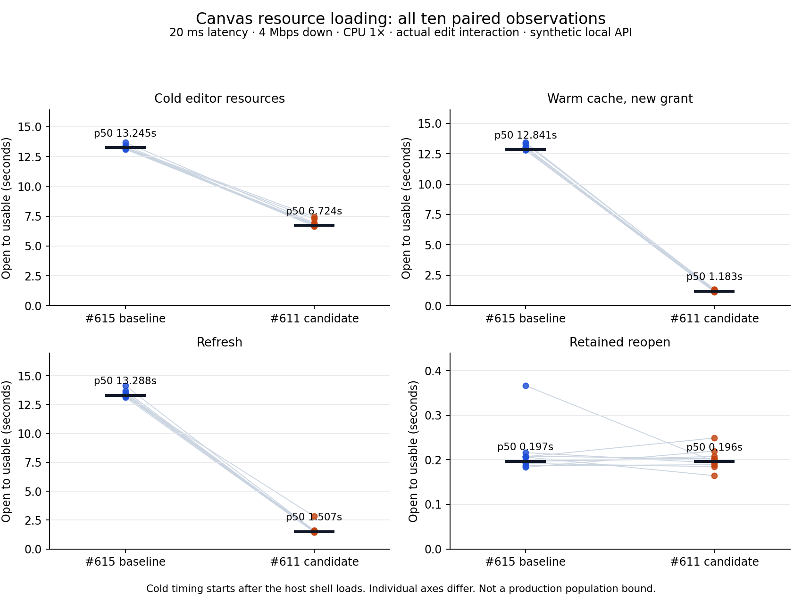

# #611 resource loading evidence

Implementation baseline: main `3cbc78d8`; coordinated math baseline: #615
`a2ec76b2316f5f5afbea8453507c88881c3fc70b`. The resource branch is stacked on that
exact math commit. No size/layout changes from #612 are included.

Measured implementation: `9737ac34e19ee59b58461b27834383486528d438`.
Later commits containing this report only add the reproducible evidence.

## Final results

Ten paired runs per entry/scenario/arm, 160 observations in total. Each table
entry below is the usable-time nearest-rank **p50 / p75 / p95 in milliseconds**.
At n=10, p95 is the observed maximum, not a production population estimate.

| Design entry | #615 baseline | Candidate | p50 reduction |
|---|---:|---:|---:|
| Cold editor resources | 13,245 / 13,283 / 13,696 | 6,724 / 6,933 / 7,446 | 49% |
| Retained reopen | 197 / 208 / 366 | 196 / 207 / 249 | effectively unchanged |
| Warm new grant/scope | 12,841 / 13,070 / 13,437 | 1,183 / 1,283 / 1,342 | 91% |
| Refresh | 13,288 / 13,541 / 14,146 | 1,507 / 1,588 / 2,822 | 89% |

Cold Design wire bytes fall from **2,901,431 to 2,446,667 (16%)** with the same
math capability. Warm new-grant transfer falls from **2,898,064 to 6,467 bytes**;
refresh is 6,798 bytes and retained reopen transfers zero. Cold request starts
increase from 12 to 14: extracting the font and moving the same runtime fetch
earlier gives a shorter critical path, rather than a lower request count. The
runtime preload and its later execution share the same cached bytes.

GenUI p50 usable times (baseline → candidate) are cold 1,566 → 1,544 ms,
reopen 214 → 220 ms, warm 506 → 513 ms and refresh 643 → 640 ms; payload sizes
are unchanged. No ordinary-path GenUI speed improvement is claimed. Its warm
p95 was 722 → 1,246 ms, with one candidate sample recording a 568 ms guest long
task. The Design refresh maximum includes 788 ms and 495 ms guest long tasks
between visible content and completed editing. These samples are retained;
the small run does not establish a population tail bound or eliminate CPU
variance. See [all distributions](evidence/distributions.md),
[raw samples](evidence/final-paired.json.gz) and
[request timelines](evidence/request-timelines.csv).



An additional CPU 4× run has only two observations per arm/scenario and is
**diagnostic**, not another quantile population. Design usable ranges were cold
18.39–18.51 → 11.82–16.74 seconds, warm 16.90–19.09 → 3.84–6.54 seconds,
refresh 16.82–21.59 → 6.09–8.85 seconds, reopen 0.79–0.88 → 0.74–1.53
seconds. GenUI cold was 2.61–2.85 → 3.38–5.40 seconds, with large CPU/long-task
variance also on warm/refresh. No slow-device GenUI performance acceptance is
claimed from this small diagnostic. The complete samples remain in
[`cpu4-diagnostic.json.gz`](evidence/cpu4-diagnostic.json.gz).

The first cold Design trace starts its runtime request about 11.89 seconds after
the first entry request on #615. The candidate starts it with the entry/CSS at
0.375 seconds, finishes its transfer at 2.37 seconds, and reuses it at 6.14
seconds. The old main bundle ends at 5.37 seconds; the candidate ends at 5.09
seconds. This separates overlap/handshake gains from the smaller compressed
payload. Grant/API reads and document CAS still occur normally.

## What changed

1. Complete the pinned Design parent reveal protocol. The old product never
   acknowledged the editor's hold request, delaying the actual board mount until
   its multi-second fallback. Only the current iframe and grant origin can ask;
   folded/hidden frames wait for visibility. The packaged editor skips the
   original 300 ms settle and 900 ms presentation waits after visibility is
   acknowledged; the original unacknowledged/standalone path remains. This
   advances the actual React/preview mount, not just the Loading placeholder.
   The editor still owns document loading and rendering.
2. Build the math-enabled Design package once. Precompute Brotli 11 and gzip 9,
   remove the large font's base64 encoding from blocking CSS without changing its
   bytes, and serve fixed renderer JS/CSS/fonts at content-hashed shared URLs.
   Entry/CSS retain anonymous CORS and SHA-256 integrity. The pinned runtime
   metadata getter changes from `pathname` to `href` so the existing external
   runtime can also use the shared URL. Its preload and eventual execution have
   one immutable cache identity. Optional Babel/worker and blob/inline fallbacks
   remain present; the upstream archive and authored files remain unchanged.
3. Bind optional GenUI math to its own eight-second cancellation signal. Expiry
   cancels both its public and authorized recovery reads and clears its pending
   cache ownership. Cancelling a follower only releases that page's wait. The
   host also closes its resource group after successful preparation.
4. Fix a #615 fallback defect: JavaScript replacement-string `$&` expansion
   corrupted KaTeX minified dollar identifiers and produced `Unexpected token
   :` when a blocked external runtime fell back to blob/inline code. A replacement
   callback preserves the exact source. The extracted whole fallback program is
   compared byte-for-byte and parsed in a regression, then exercised by blocking
   the actual shared runtime in Chromium. The fix is isolated in `f9406c2f` for
   the #615 owner if it needs to be applied before this branch.
5. A failed trusted Design entry/stylesheet reports a recoverable error. Grant
   acquisition and shell initialization are bounded, and HTML load by itself
   does not count as a running editor. Retry obtains a fresh grant.

## Measurement conditions

Chromium 154.0.8037.57, Linux 6.18.57, Xeon Platinum 8573C; React/React DOM
19.2.8, KaTeX 0.16.47, Vite 5.4.21. Viewport 1440×1000, 20 ms latency,
4 Mbps down / 3 Mbps up, CPU 1×. CDP applies the same profile to the parent and
every OOPIF. Final A/B ordering alternates AB/BA for ten fresh contexts per arm
and entry. No build, test suite or other browser benchmark runs concurrently.

`fixture.tsx` uses actual DesignWorkspace/ArtifactEditorFrame and GenUiCard.
`serve.ts` serves actual editor/runtime bytes and the existing isolated-editor
gateway. Only documents, capability issuance, state and HTTP API replies are
synthetic. Its scoped documents support real editor CAS publish, while GenUI
controls use the real SDK. This measures resource/browser latency, not production
authentication, Postgres/Redis, IM, LLM work, internet/CDN geography or the user's
unprovided artwork. No Lenovo browser or production data was used.

- Cold: fresh browser context, load the fixture host, then open the entry with
  cold editor/visualization resources. Timing excludes initial host-shell loading
  and login; this is not a whole-product startup benchmark.
- Retained reopen: close/reopen in the same context.
- Warm: open another conversation/scope in the same context, obtaining a new grant.
- Refresh: navigate back to the original page, keeping the browser HTTP cache.
- Visible: the authored heading has layout. Design additionally waits for two
  animation frames; GenUI checks its real execution context plus the visible
  guest bounds because Chromium's retained-frame move can stale Playwright's
  frame map. These are browser visibility proxies, not video-derived paint times.
- Usable: an actual mouse action makes a Design heading editable, or a GenUI
  increment completes its SDK state acknowledgement. Loading/onload alone does
  not qualify. Reported time includes the automated user's click dispatch.

The final fixture uses HTTPS sibling subdomains of `loop.test`, matching the
production origin topology. A generated *test-only* certificate is pinned by
SPKI in the test Chromium invocation. No system trust store, product certificate,
product browser flags or security policy is changed. Plain localhost subdomains
partition cache differently; merely ignoring a TLS certificate error also
disabled Chromium's cache in this environment. Those pilot results are excluded
from final cache claims.

## Validation and limits

Focused real-host/cache/recovery tests verify both stalled read routes, immediate
reacquisition after timeout, and follower cancellation without aborting another
owner. A real Chromium host test also hangs both the public math fetch and its
authorized recovery fetch: the view becomes usable at 8.59 seconds, the fixture
observes **two started and zero remaining network reads**, retained reopen adds
none, and a new scope becomes usable in 1.42 seconds without inheriting the old
five-second shared wait. See [`browser-cancellation.json`](evidence/browser-cancellation.json).
Build tests decompress every sidecar, compare executable bytes to the
explicit agreed adaptations, and reconstruct the original font/CSS exactly.
Gateway tests preserve grant-host binding, credential stripping and forbidden
API/project routes. Public-route/private-path assertions were added to the
owning real-DB integration test.

The production Web build, Web typecheck/lint, 149 Web smoke/owning tests,
server lint, owning build/CI-scope
checks and isolated gateway unit tests passed locally. The cloud image contains
SDK **3.8.16**, despite both lockfiles requiring **3.8.21**. Installing the exact
locked published archive returned GitHub Packages **401 Unauthorized**. Local
full server typecheck therefore failed on pre-existing native-v3 SDK API types;
real-DB integration was not run with that incompatible SDK. No dependency lock,
credential or SDK source was substituted. An extra unmodified Miniflare static
HTML test could not start because its module fixture omitted the imported
`shared/artifact-editor-origin.ts`; it is not reported as passing.

The earlier #615 opaque-host blank view was a fixture mismatch: at the baseline,
`ArtifactEditorFrame` already used a unique grant origin, and the production
`workers/web-static` gateway already called `isolatedEditor`, which gives only
that trusted shell same-origin access to its own child frames. The main-site
response stays opaque. This task changes neither that gateway nor the sandbox
attributes. The joint browser regression checks the real response CSP and
renders six formulas with five loaded KaTeX faces through the actual outer
component, then checks dynamic update and retained reopen. It also verifies
real text editing and CAS publication, saved refresh, conversation isolation,
12 retained reopens with one iframe, resource-error retry, and blocked-runtime
blob fallback with all six formulas. Screenshots and the exact report are in
`evidence/browser-regressions.json` and adjacent PNG files.

## Remaining cost and rollback

The pinned editor is still a large monolithic program; caching removes transfer,
but each new document still parses/initializes the editor and preview runtime.
KaTeX's agreed self-contained font payload is preserved; the final code has
no known deliberate parent-presentation wait after the visibility acknowledgement.
At 4 Mbps, 2,446,667 transferred bytes alone imply approximately **4.89 seconds**
at a shared 500,000 bytes/s link, before request latency and CPU work. The measured
6.72-second cold p50 still has about 1.83 seconds beyond that approximate floor.
This is a throughput-based bound for these bytes, not proof of global optimality.
The program still contains its self-sufficient inline fallback runtime/math;
new frames repeat initialization and two small canvas reads. Splitting/replacing
the archived editor or changing math rendering coverage is outside this bounded
change. Warm-load CPU and the observed long tasks remain measurable costs.

No migration or durable-format change. Revert this task's commits, rebuild and
deploy the compatible application/SDK 3.8.21 release through the designated integrator.
#615 remains the math dependency. This task does not merge, deploy, publish an
SDK, approve itself or close the issue. Final-head independent review and actual
production-entry acceptance remain with the parent integrator.

## Reproduction

Use a separate worktree at `a2ec76b2` and its generated
`build:visualize-runtime` output as A. Build this branch's
`build:visualize-runtime` as B. Build each production fixture using
`node perf/issue-611/build.mjs <source-root> <output-directory>`.
Create the short-lived local test certificate with:

```sh
openssl req -x509 -newkey rsa:2048 -nodes -keyout /tmp/611-fixture-key.pem -out /tmp/611-fixture-cert.pem -days 2 -subj /CN=loop.test -addext 'subjectAltName=DNS:*.loop.test,DNS:loop.test,IP:127.0.0.1'
```

Start two fixture servers in separate processes, substituting local worktree and
build paths:

```sh
PERF_TLS=1 PERF_DESIGN_DIST=<A-root>/server/assets/design-editor node --import tsx perf/issue-611/serve.ts <A-root> <A-web-output> 4195
PERF_TLS=1 PERF_DESIGN_DIST=<B-root>/server/assets/design-editor node --import tsx perf/issue-611/serve.ts <B-root> <B-web-output> 4194
python3 perf/issue-611/bench.py --urls https://app.loop.test:4195/ https://app.loop.test:4194/ --runs 10 --out /tmp/611-final.json
python3 perf/issue-611/regression.py
python3 perf/issue-611/cancel-regression.py
python3 perf/issue-611/summarize.py /tmp/611-final.json /tmp/611-summary
python3 perf/issue-611/plot.py /tmp/611-final.json /tmp/611-distribution.png
```

The script resolves only those test domains to loopback, pins only the local
certificate, and retains sanitized request traces, frame resource/long-task
entries, host CPU/heap deltas and screenshots. Host CPU metrics are not total
cross-process browser CPU; retained-frame long-task arrays are cumulative.
Historical `design-baseline.json.gz`, `visualize-baseline.json.gz` and `experiments.json.gz`
are explicitly **diagnostic**, with their own profiles and pre-math baselines.
`cache-stage-paired.json.gz` is the complete earlier 10-pair stage before the final
presentation-wait/fallback fix; it is not the final candidate result.

Large raw traces are losslessly gzip-compressed to keep review diffs readable. Both `summarize.py` and `plot.py` accept `.json` or `.json.gz`.
